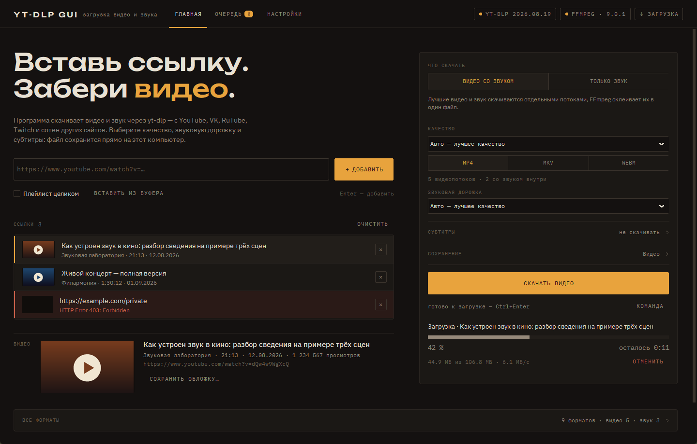
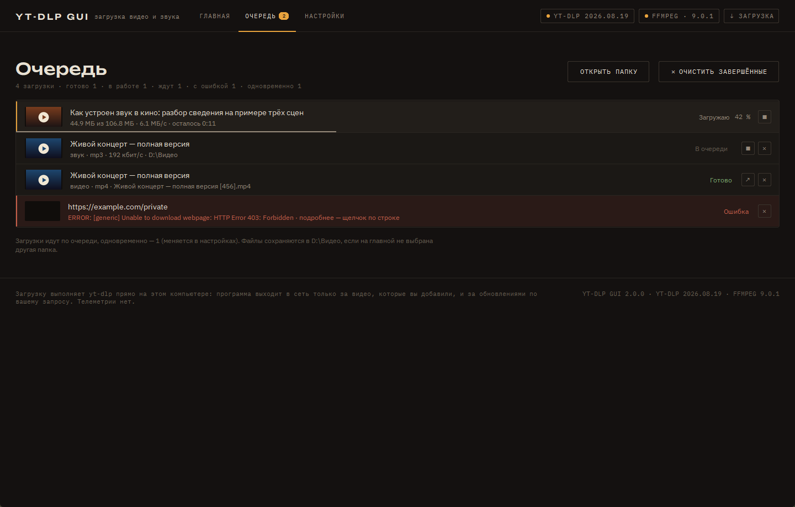
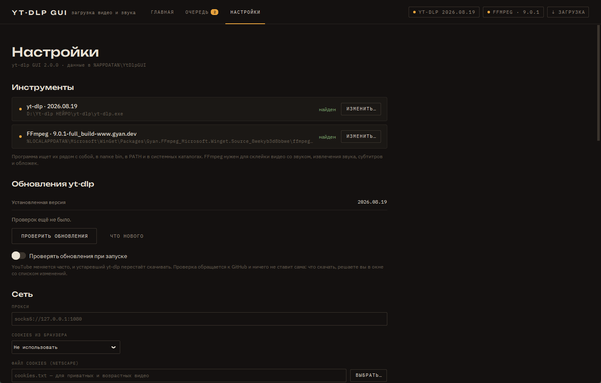
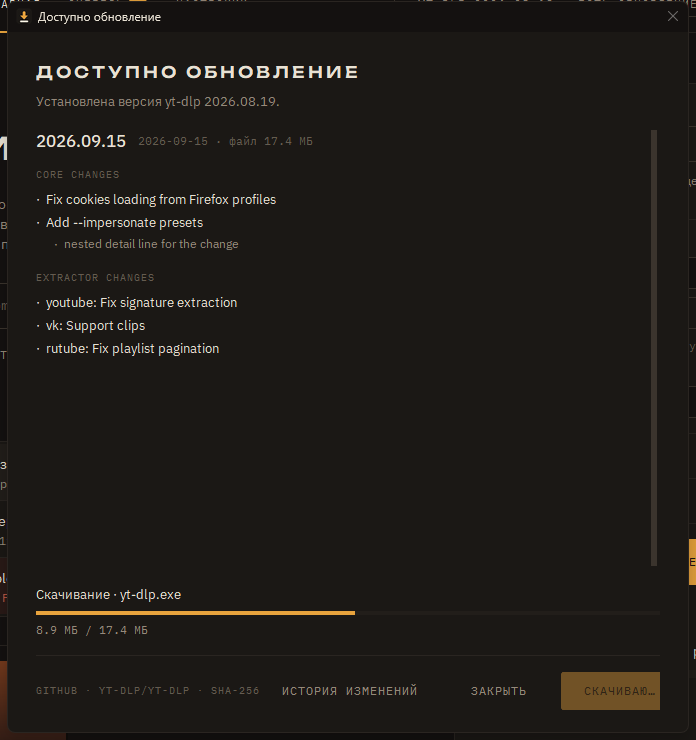

# yt-dlp GUI

Графический интерфейс для [yt-dlp](https://github.com/yt-dlp/yt-dlp) под Windows:
скачивание видео и аудио с YouTube и других поддерживаемых сайтов, очередь загрузок,
субтитры, звуковые дорожки, встроенное обновление самого yt-dlp.

Оформление перенесено из «Стемницы»: тёплая тёмная «приборная панель»,
шапка с вкладками «Главная · Очередь · Настройки» и чипами состояния,
моноширинные капс-подписи и один янтарный акцент. Шрифты IBM Plex и Unbounded
встроены в приложение, масштаб интерфейса — 80–160 %.



## Возможности

- **Главная** — ссылка, список добавленных видео, карточка выбранного и панель
  параметров: что скачать (видео со звуком или только звук), качество, субтитры,
  папка; ход загрузки виден прямо под кнопкой «Скачать».
- **Видео** — выбор качества и контейнера (mp4/mkv/webm), звуковой дорожки
  (например, другого языка озвучки), субтитров: вшить, сохранить отдельно или и то,
  и другое.
- **Аудио** — извлечение звука в mp3/m4a/opus/flac/wav с выбором битрейта.
- **Сведения о видео** — обложка, канал, длительность, дата, просмотры и полная
  таблица доступных форматов (раздел «Все форматы» на главной).
- **Очередь** — прогресс, скорость, оставшееся время, этапы постобработки, отмена,
  открытие папки результата, журнал задания; итоги — уведомлениями в углу окна.
- **Cookies** — прямо из браузера (Chrome, Edge, Firefox, Brave, Chromium, Opera,
  Vivaldi, Whale; на macOS ещё Safari) либо файлом в формате Netscape.
- **Обновление yt-dlp** — проверка релизов на GitHub, окно со списком изменений и
  установка в один клик с проверкой SHA-256.
- Прокси, ограничение скорости, шаблон имени файла, параллельные загрузки.

| Очередь | Настройки | Обновление yt-dlp |
|---|---|---|
|  |  |  |

## Запуск из исходников

```bash
pip install -r ytdlp_gui/requirements.txt
python ytdlp_gui/main.py
```

Нужен Python 3.12+. Зависимости: `customtkinter`, `pillow` (обе — из
`ytdlp_gui/requirements.txt`); всё остальное — стандартная библиотека.

### Внешние бинарники

В репозитории их нет — это чужие сборки со своими релизами и лицензиями:

| | Обязателен | Где взять |
|---|---|---|
| **yt-dlp** | да | [релизы yt-dlp](https://github.com/yt-dlp/yt-dlp/releases) — положите `yt-dlp.exe` в корень проекта или укажите путь в настройках |
| **FFmpeg** | для слияния видео и звука, извлечения аудио, субтитров и обложек | [ffmpeg.org](https://ffmpeg.org/download.html); достаточно, чтобы он был в `PATH` |

Приложение ищет их рядом с собой, в подкаталоге `bin`, в `PATH` и в стандартных
каталогах системы; путь можно задать вручную в разделе «Настройки».

## Сборка в один файл

```bash
pip install pyinstaller
pyinstaller ytdlp-gui.spec --noconfirm
```

Результат — `dist/ytdlp-gui.exe`: один файл, который можно перенести куда угодно и
запустить из любого каталога. Внутрь вшиваются переводы, шрифты, значок и `yt-dlp.exe`
из корня проекта (если это onedir-сборка — вместе с её каталогом `_internal`).
FFmpeg не вшивается: он нужен не всегда и весит больше самого приложения.

## Структура

```
ytdlp_gui/
  app/          настройки, состояние сессии, шина событий, фасад Application
  core/         доменные модели, сборка команды yt-dlp, валидация, обновления
  services/     поиск бинарников, сведения о видео, превью, процессы,
                очередь загрузок, GitHub Releases
  gui/          главное окно, вкладки, визуальная система и компоненты
  resources/    переводы, шрифты (IBM Plex, Unbounded), значок
tools/          генератор значка
ytdlp-gui.spec  сборка в один .exe
```

Подробности по разделам, горячим клавишам и хранению настроек — в
[ytdlp_gui/README.md](ytdlp_gui/README.md), список версий — в
[CHANGELOG.md](CHANGELOG.md).

## Лицензия

Не выбрана. Репозиторий закрытый; перед публикацией стоит определиться —
учтите, что yt-dlp распространяется под [Unlicense](https://github.com/yt-dlp/yt-dlp/blob/master/LICENSE),
а FFmpeg под LGPL/GPL. Шрифты IBM Plex и Unbounded — SIL Open Font License
(тексты лицензий лежат рядом со шрифтами в `ytdlp_gui/resources/fonts`).
